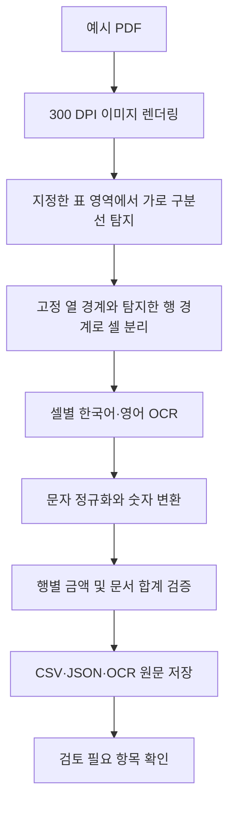

# 선박 물품 공급명세서 OCR 프로젝트 진행 기록

작성일: 2026-10-15  
작업 기준 폴더: `W5/`

## 1. 프로젝트 목적과 현재 결과

이 프로젝트는 선박에 물품을 공급했다는 사실과 품목별 거래 내역이 기재된 서류에서, 물품 정보를 데이터로 추출하는 과정을 실습하기 위해 시작했다.

대화에서는 이를 “물품계약서”, “계약공급서”라고 표현했다. 실제 제작한 예시의 제목은 **선박 물품 공급명세서**이며, 공급자·공급받는 자·선박·공급일·물품 내역·금액·인수 확인을 담았다.

작업은 다음 순서로 진행했다.
...
1. 여러 선용품이 들어간 한 장짜리 가상 공급명세서 PDF 제작.
2. 해당 PDF를 이미지로 변환하여 물품 표를 OCR로 읽는 단일 Python 파일 작성.
3. OCR 추출 결과를 CSV·JSON·텍스트로 저장하고, 원본 데이터와 비교하여 검증.
4. 추가 가상 공급명세서 10건과 비교용 정답 데이터 생성.
5. 프롬프트, 설계, 구현, 검증 결과와 한계를 이 Markdown 문서로 기록.

현재 확보한 자료는 다음과 같다.

| 구분 | 수량 | 용도 |
| --- | ---: | --- |
| 최초 선박 공급명세서 PDF | 1쪽, 16개 품목 | 실제 OCR 동작 확인 |
| OCR 실행 코드 | Python 파일 1개 | 이미지 인식, 구조화, 검증, 저장 |
| 원본 PDF의 OCR 결과 | CSV·JSON·TXT 각 1개 | 인식값과 검토 필요 항목 확인 |
| 추가 mock 명세서 | TXT 10건, 각 16개 품목 | 다양한 거래 내역의 예시 입력 |
| 추가 mock 정답 데이터 | JSON 1개, CSV 1개 | 총 160개 품목 행의 기준 데이터 |
| 추가 데이터 배포 묶음 | ZIP 1개 | 위 TXT·JSON·CSV와 안내문 전달 |

최초 PDF와 추가 mock 자료를 합치면 명세서 예시는 총 11건이고, 품목 행은 총 176개다. 이 가운데 **실제 OCR 실행과 원본 대조를 수행한 대상은 최초 PDF 1건**이다.

## 2. 사용자가 입력한 주요 프롬프트

아래는 이번 프로젝트의 목표 설정부터 데이터 확장까지 이어진 사용자 프롬프트 원문이다. 띄어쓰기와 구어체 표현을 유지했다.

### 프롬프트 1. 선박 공급 내역이 들어간 한 장짜리 예시 요청

> 내가 선박회사이고 이런물품 이런물품 공급했다는 그런 서류 있잖아. 왜냐하면 그런 서류에서 물품들을 데이터로 뽑아내는 그런 프로젝트를 하고싶어서. 여러 물품들이 계약공급서에 들어갔으면 좋겠어 한장짜리 예시로

이 요청에서 정리한 요구사항은 다음과 같다.

- 선박 관련 물품 공급 상황을 가정한다.
- 빈칸만 있는 양식보다 실제 값이 채워진 가상 거래 예시가 필요하다.
- 한 문서 안에 여러 물품이 있어야 한다.
- 물품 정보를 행과 열로 추출할 수 있는 표 구조가 필요하다.
- 결과물은 한 장짜리 예시 서류여야 한다.

이에 따라 A4 세로 한 장에 회사 정보, 선박 정보, 16개 물품 표, 금액 요약, 공급·인수 확인을 배치했다.

### 프롬프트 2. 단일 Python 파일로 OCR 코드 요청

> 이거 그 OCR로 추출하는 코드좀 만들어줄수있어? py 파일 하나만 써서

이 요청에서는 프로그램 소스를 하나의 `.py` 파일로 제공하는 것을 우선했다.

프로그램은 PDF의 텍스트를 바로 읽는 방식 대신, PDF를 이미지로 렌더링한 뒤 각 표 칸을 OCR로 인식하도록 구현했다. 인식 결과는 프로젝트에서 재사용할 수 있도록 CSV와 JSON으로 저장하고, 대조용 OCR 원문도 남겼다.

“Python 파일 하나”는 프로그램 소스의 구성에 대한 조건이다. 실행에는 외부 라이브러리와 한국어·영어 OCR 모델 파일이 필요하며, 실행 결과 파일도 별도로 생성된다.

### 프롬프트 3. 추가 mock data 약 10개 요청

> 지금 우리가 mock data 우리 물품계약서에 있는 데이터를 예시로 10개 정도 더. 만들어줄수있어? 이건 pdf일필요없어

“10개”는 추가 품목 10개가 아니라 **추가 공급명세서 10건**으로 해석하여 진행했다. 기존 예시와 같은 규모로 각 명세서에 16개 품목을 넣었다.

PDF가 필수는 아니라는 조건에 맞춰 다음 세 가지 형태로 제공했다.

- 사람이 읽을 수 있는 공급명세서 TXT 10개.
- 문서별 기본 정보·품목·합계를 담은 JSON 정답 데이터.
- 전체 160개 품목 행을 모은 통합 CSV.

## 3. 한 장짜리 선박 공급명세서 제작

### 3.1 문서 정보

생성 파일: [선박 물품 공급명세서 예시 PDF](output/pdf/선박_물품공급명세서_예시.pdf)

| 항목 | 예시 값 |
| --- | --- |
| 문서 제목 | 선박 물품 공급명세서 |
| 영문 보조 제목 | SHIP SUPPLY STATEMENT / 납품 및 인수 확인 |
| 문서번호 | HBM-SS-2026-1015-001 |
| 발행일자 | 2026-10-15 |
| 공급자 | 한빛마린서플라이㈜ |
| 공급받는 자 | 청해해운㈜ |
| 선박명 | M/V CHEONGHAE STAR |
| 발주번호 | CHS-PO-2026-1008 |
| 공급일 | 2026-10-15 |
| 공급장소 | 부산항 제3부두 |
| 납품상태 | 전 품목 인도 완료 |
| 통화 | KRW |
| 지급조건 | 납품일로부터 30일 이내 계좌이체 |
| 포장·운송비 | 공급자 부담 |

회사, 주소, 담당자, 선박 및 거래 정보는 모두 가상이다. 이메일은 `example.com` 도메인을 사용했고, 문서 하단에도 데이터 추출 연습용 가상 문서임을 표시했다.

### 3.2 표의 데이터 구조

품목 표는 다음 8개 열로 구성했다.

| 열 | 의미 | 데이터 처리 방식 |
| --- | --- | --- |
| 번호 | 문서 안의 품목 순서 | 정수 |
| 품목코드 | 품목을 식별하는 예시 코드 | 문자열 |
| 품명 | 물품 이름 | 문자열 |
| 규격 / 사양 | 모델, 재질, 치수, 용량 등 | 문자열 |
| 수량 | 공급한 포장·물품 단위의 개수 | 정수 |
| 단위 | 통, 개, 롤, 벌, 대, 박스 등 | 문자열 |
| 단가 | 해당 공급 단위 1개당 가격 | 원 단위 정수, 부가세 별도 |
| 금액 | 수량 × 단가 | 원 단위 정수, 부가세 별도 |

예를 들어 `SAE 40 / 20 L` 윤활유의 수량 `12`, 단위 `통`은 20 L 용기 12통을 뜻한다. 금액을 계산할 때 수량 12에 용량 20을 다시 곱하지 않는다.

### 3.3 최초 예시의 전체 물품 내역

아래 표는 OCR 결과가 아니라 **PDF를 만들 때 사용한 원본 값**이다. OCR 결과를 평가할 때 이 값을 기준으로 비교했다.

| 번호 | 품목코드 | 품명 | 규격 / 사양 | 수량 | 단위 | 단가(원) | 금액(원) |
| ---: | --- | --- | --- | ---: | --- | ---: | ---: |
| 1 | EN-101 | 주기관 윤활유 | SAE 40 / 20 L | 12 | 통 | 98,000 | 1,176,000 |
| 2 | EN-102 | 유압 작동유 | ISO VG 46 / 20 L | 6 | 통 | 87,000 | 522,000 |
| 3 | EN-103 | 오일 필터 | OF-220 / 카트리지 | 8 | 개 | 32,500 | 260,000 |
| 4 | EN-104 | 연료 필터 | FF-310 / 10 μm | 10 | 개 | 28,000 | 280,000 |
| 5 | EN-105 | 해수 펌프 임펠러 | IMP-65 / Ø65 mm | 3 | 개 | 145,000 | 435,000 |
| 6 | DK-201 | 계선 로프 | PP / Ø24 mm × 200 m | 2 | 롤 | 385,000 | 770,000 |
| 7 | DK-202 | 와이어 로프 | 6×19 / Ø12 mm × 50 m | 2 | 롤 | 215,000 | 430,000 |
| 8 | DK-203 | 샤클 | SUS316 / M20 | 20 | 개 | 18,500 | 370,000 |
| 9 | SF-301 | 구명조끼 | 성인용 / 150 N | 15 | 벌 | 68,000 | 1,020,000 |
| 10 | SF-302 | 안전모 | 턱끈형 / 백색 | 12 | 개 | 24,500 | 294,000 |
| 11 | SF-303 | 분말 소화기 | ABC / 3.3 kg | 6 | 대 | 42,000 | 252,000 |
| 12 | EL-401 | LED 작업등 | AC 220 V / 50 W | 8 | 개 | 56,000 | 448,000 |
| 13 | EL-402 | 선박용 케이블 | 3C × 2.5 mm² / 100 m | 2 | 롤 | 248,000 | 496,000 |
| 14 | PT-501 | 방청 프라이머 | 회색 / 18 L | 4 | 통 | 135,000 | 540,000 |
| 15 | PT-502 | 갑판용 페인트 | 녹색 / 18 L | 4 | 통 | 158,000 | 632,000 |
| 16 | CS-601 | 흡착 패드 | 유흡착용 / 100매 | 5 | 박스 | 59,000 | 295,000 |

합계는 다음과 같다. 부가세 10%는 이번 가상 데이터에 적용한 계산 조건이다.

| 구분 | 금액(원) |
| --- | ---: |
| 공급가액 | 8,220,000 |
| 부가세 10% | 822,000 |
| 합계금액 | 9,042,000 |

### 3.4 제작과 화면 검수

ReportLab으로 PDF를 생성하고 한글 글꼴을 포함했다. 이후 PyMuPDF로 페이지를 PNG 이미지로 렌더링하여 실제 화면을 확인했다.

검수에서는 다음 사항을 확인했다.

- PDF가 정확히 한 쪽인지.
- 회사 정보, 16개 품목, 합계, 인수 확인이 한 페이지 안에 들어가는지.
- 표의 열, 한글, 영문, 숫자, 특수기호가 읽히는지.
- 텍스트 겹침이나 페이지 밖으로 잘리는 부분이 없는지.
- 각 품목의 금액과 최종 합계가 계산 결과와 일치하는지.

제작용 보조 소스는 [create_ship_supply.py](tmp/pdfs/create_ship_supply.py)에 있다. 이 소스는 정답 값의 출처이며, OCR 프로그램은 이 파일을 읽지 않는다.

## 4. 단일 Python OCR 프로그램

실행 파일: [ship_supply_ocr.py](ship_supply_ocr.py)

### 4.1 사용 기술과 검증 환경

| 구성 | 역할 | 이번 실행에서 확인한 버전 |
| --- | --- | --- |
| Python | 프로그램 실행 | 3.9.6 |
| PyMuPDF | PDF 페이지를 이미지로 변환 | 1.26.5 |
| Pillow | 이미지 자르기, 명암 처리, 반전 | 11.3.0 |
| tesserocr | Tesseract 엔진을 Python에서 호출 | 2.11.0 |
| tessdata_fast | 한국어·영어 인식 모델 | `kor.traineddata`, `eng.traineddata` |

검증은 현재 macOS 환경에서 수행했다. 다른 운영체제나 Python 버전에서는 `tesserocr` 설치에 필요한 바이너리 또는 시스템 라이브러리 조건이 달라질 수 있다.

OCR 모델을 새로 학습하거나 미세 조정하는 작업은 하지 않았다. 공개된 한국어·영어 모델을 사용했다.

### 4.2 전체 처리 흐름



PDF에 텍스트 레이어가 있더라도 추출 과정에서는 사용하지 않는다. `get_pixmap()`으로 렌더링한 이미지를 인식 대상으로 삼는다. 따라서 이번 검증은 이미지 기반 문자 인식 경로를 실제로 거쳤다.

### 4.3 이미지 생성과 입력 조건

PDF의 기본 렌더링 해상도는 300 DPI다. 코드에는 같은 비율의 PNG·JPG 등 이미지 파일을 읽는 경로도 있다. 이번에 원본과 대조하여 검증한 입력은 PDF다.

입력은 예시와 같은 A4 세로 배치라고 가정한다. 이미지 크기가 달라져도 좌표를 비례 환산하지만, 내용의 위치나 표 구조가 달라지는 경우까지 자동 대응하지는 않는다.

### 4.4 표와 행을 찾는 방식

표 영역과 열의 경계는 예시 서류의 위치에 맞춰 지정했다.

```python
PAGE_WIDTH, PAGE_HEIGHT = 595.2756, 841.8898
TABLE_AREA = (32, 303, 563.2756, 648)
COLUMN_EDGES = (32, 52, 96, 197, 296, 319, 344, 398, 563.2756)
```

이 좌표는 PDF 포인트 기준이며, 원점이 이미지 왼쪽 위가 되도록 환산하여 사용한다.

행 경계는 이미지의 가로 구분선을 찾아 결정한다. 지정한 표 너비의 대부분이 어두운 픽셀로 이어지는 줄을 구분선 후보로 잡고, 연속된 픽셀 줄을 하나의 경계로 묶는다. 코드에서는 후보 행 높이를 15~28포인트로 제한했다.

품목 수를 무조건 16으로 정해 추출하지는 않는다. 다만 탐색 영역과 하단 합계 위치는 현재 예시의 배치에 맞춰져 있으므로, 품목이 늘거나 페이지 구성이 바뀌면 좌표도 다시 설정해야 한다.

### 4.5 셀별 OCR 설정

| 셀 종류 | 언어 설정 | 처리 목적 |
| --- | --- | --- |
| 품명·단위 등 | `kor+eng` | 한글과 영문이 섞인 내용 인식 |
| 번호·수량·단가·금액 | `eng` | 숫자와 쉼표 중심 인식 |
| 품목코드 | `eng` | 영문 대문자·숫자·하이픈 중심 인식 |
| 규격 | `eng+kor`, 추가로 `kor+eng` | 언어 우선순위별 인식 차이 확인 |

한 셀을 한 줄로 읽도록 `PSM.SINGLE_LINE`을 사용한다. 숫자와 품목코드는 허용 문자를 제한한다.

규격은 두 언어 순서로 각각 인식한다. 두 결과가 정규화와 공백 제거 후에도 다르면 검토 대상으로 표시한다. 어느 결과가 정답인지를 자동으로 확정하거나 원본 값으로 덮어쓰지는 않는다.

### 4.6 이미지 전처리와 값 변환

셀을 읽기 전에는 테두리가 덜 섞이도록 안쪽을 잘라내고, 회색조 변환과 자동 대비 조정을 수행한다. 어두운 배경의 합계 칸은 명암을 반전한다. 셀 주변에는 흰 여백을 추가한다.

OCR 이후에는 다음 처리를 수행한다.

- Unicode NFKC 정규화로 전각 영문·숫자 등의 표현을 정리한다.
- 문자열의 연속 공백을 정리한다.
- 숫자 필드에서 공백, 통화 표시, 천 단위 쉼표를 처리한다.
- 숫자 형식이 유효한 경우에만 정수로 변환한다.
- 읽지 못한 숫자는 `None`, 즉 JSON의 `null`로 남긴다.

예를 들어 `1,176,000`은 정수 `1176000`으로 변환한다. 문자가 섞여 숫자로 해석할 수 없는 값은 0으로 바꾸지 않는다. `O`를 `0`으로 추측하여 치환하는 규칙도 넣지 않았다.

### 4.7 검증과 검토 표시

행 단위 검증 항목은 다음과 같다.

- 필수 값이 비어 있거나 숫자 변환에 실패했는지.
- OCR 신뢰도가 지정한 기준 미만인지. 기본 기준은 70이다.
- 인식한 번호가 문서 내 행 순서와 일치하는지.
- 품목코드가 예시 형식인 `영문 대문자 2개-숫자 3개`와 맞는지.
- 규격을 두 언어 순서로 읽은 결과에 차이가 있는지.
- 규격에 `@`, `?` 등 기술 기호 오인식이 의심되는 문자가 있는지.
- `수량 × 단가 = 금액`인지.

문서 단위로는 다음 계산을 대조한다.

```text
공급가액 = 품목 금액의 합계
부가세 = 공급가액 × 10%, 원 미만 버림
합계금액 = 공급가액 + 부가세
```

공급가액·부가세·합계금액도 요약 칸을 OCR로 읽는다. 따라서 계산한 값과 서류에서 인식한 요약 값을 비교할 수 있다.

금액 검증이 통과해도 품명이나 규격이 모두 정확하다는 뜻은 아니다. 또한 신뢰도가 높아도 오인식이 남을 수 있으므로, 신뢰도와 합계 검사만으로 전체 정답 여부를 판단하지 않는다.

### 4.8 주요 함수

| 함수 | 역할 |
| --- | --- |
| `ensure_models()` | 한국어·영어 모델을 확인하고 필요 시 다운로드 |
| `load_pages()` | PDF 또는 이미지를 열고 페이지 이미지를 제공 |
| `crop()` | 기준 좌표를 실제 이미지 크기로 환산하여 자르기 |
| `find_rows()` | 표의 가로 구분선과 행 경계 탐지 |
| `recognize()` | 셀별 전처리, OCR 원문과 신뢰도 반환 |
| `integer_or_none()` | 숫자 형식을 검사하여 정수 또는 `None` 반환 |
| `extract_page()` | 셀 인식, 구조화, 금액 검증, 검토 사유 수집 |
| `save_results()` | CSV·JSON·TXT 저장 |
| `main()` | 실행 옵션 처리와 전체 흐름 제어 |

### 4.9 현재 추출하는 범위

현재 프로그램이 구조화하는 정보는 **품목 8개 열과 금액 요약**이다. 회사명·선박명·문서번호·발주번호·공급일 등을 별도 필드로 OCR 추출하는 기능은 아직 구현하지 않았다.

추가 mock JSON에는 이러한 문서 기본 정보가 들어 있지만, 이는 mock 자료 생성 단계에서 작성한 값이다. 현재 OCR 프로그램이 읽어낸 결과와 구분해야 한다.

## 5. 실행 방법과 결과 확인

### 5.1 설치 및 기본 실행

프로젝트 기준 폴더에 `ship_supply_ocr.py`와 `output/pdf/선박_물품공급명세서_예시.pdf`가 있는 상태에서 실행한다.

```bash
python3 -m pip install pymupdf pillow tesserocr
python3 ship_supply_ocr.py
```

버전을 이번 검증 환경과 맞추려면 다음 설치 명령을 사용할 수 있다.

```bash
python3 -m pip install pymupdf==1.26.5 pillow==11.3.0 tesserocr==2.11.0
```

최초 실행에는 공식 `tessdata_fast` 저장소에서 한국어·영어 모델을 내려받기 위한 인터넷 연결이 필요하다. 기본 저장 위치는 `output/ocr/.tessdata/`다. 이후 모델 파일이 있으면 재사용한다. 문서 이미지를 외부 OCR API에 전송하는 기능은 없다.

### 5.2 입력과 출력 경로 지정

```bash
python3 ship_supply_ocr.py "output/pdf/선박_물품공급명세서_예시.pdf" --out "output/ocr"
```

해상도와 신뢰도 기준도 지정할 수 있다.

```bash
python3 ship_supply_ocr.py --dpi 300 --min-confidence 70
```

이미 내려받은 언어 모델 폴더를 재사용하려면 다음과 같이 실행한다.

```bash
python3 ship_supply_ocr.py --tessdata "output/ocr/.tessdata"
```

`--dpi`는 150~600, `--min-confidence`는 0~100 범위에서 지정할 수 있다. 해상도를 높인다고 모든 필드가 더 정확해지는 것은 아니므로 변경 후에는 결과를 다시 대조해야 한다.

### 5.3 종료 코드

| 코드 | 의미 |
| ---: | --- |
| 0 | 추출을 완료했고 검토 사유가 없으며 금액 검증을 통과함 |
| 1 | 라이브러리, 모델, 입력 파일, 표 탐지 등 실행 중 오류 발생 |
| 2 | 결과 파일은 생성했으나 사람이 검토할 항목이 남아 있음 |

최종 예시 실행은 규격 등 검토 항목이 있어 **종료 코드 2**로 끝났다. 실행 실패와 구분해야 한다.

### 5.4 저장 파일

| 파일 | 내용 |
| --- | --- |
| [품목 CSV](output/ocr/선박_물품공급명세서_예시_items.csv) | 품목 값, 금액 검증, 검토 여부, 검토 사유 |
| [상세 JSON](output/ocr/선박_물품공급명세서_예시_result.json) | 페이지별 품목·요약·검증·셀 원문·신뢰도·규격 대체 인식값 |
| [OCR 원문 TXT](output/ocr/선박_물품공급명세서_예시_ocr.txt) | 표 칸에서 읽은 원문을 행 단위로 정리한 텍스트 |

TXT는 전체 페이지의 모든 문구를 OCR한 결과가 아니다. 현재 추출 대상으로 삼은 표 셀과 금액 요약의 인식 원문이다.

CSV는 한글을 열기 쉽도록 UTF-8 BOM으로 저장한다. JSON은 한글을 그대로 읽을 수 있도록 `ensure_ascii=False`로 저장한다.

## 6. 최초 PDF의 OCR 검증 결과

### 6.1 확인 방법

OCR 결과를 PDF 생성에 사용한 원본 품목 값과 비교했다. 정답 값은 검증 단계에서만 사용했으며, OCR 프로그램이 값을 인식하거나 채우는 데 사용하지 않았다.

다음 항목을 실제로 확인했다.

- 16개 품목이 모두 추출되었는지.
- 각 품목의 코드·품명·수량·단위·단가·금액이 원본과 일치하는지.
- CSV에도 16개 품목 행이 저장되었는지.
- 요약 금액과 각 계산 검증이 일치하는지.
- 규격 등 검토 필요 항목이 결과에 남아 있는지.

### 6.2 일치한 항목

검증한 예시 1건에서 16개 품목의 **품목코드·품명·수량·단위·단가·금액**이 원본과 일치했다.

| 금액 검증 | 결과 |
| --- | --- |
| 모든 품목의 수량 × 단가 = 금액 | 통과 |
| 품목 금액 합계 = 공급가액 8,220,000원 | 통과 |
| 공급가액의 10% = 부가세 822,000원 | 통과 |
| 공급가액 + 부가세 = 합계 9,042,000원 | 통과 |

이는 해당 가상 PDF 1건에서의 결과다. 서로 다른 공급업체 양식이나 촬영 문서 전체에 대한 정확도 측정은 수행하지 않았다.

### 6.3 규격의 실제 오인식 사례

최종 저장된 JSON에는 다음과 같은 인식 차이가 남았다.

| 품목 | 원본 규격 | 최종 OCR 규격 값 | 확인 사항 |
| --- | --- | --- | --- |
| 연료 필터 | `FF-310 / 10 μm` | `FF-310/ 10 um` | 마이크로 기호 `μ`가 `u`로 바뀜 |
| 해수 펌프 임펠러 | `IMP-65 / Ø65 mm` | `IMP-65 / @65 mm` | 지름 기호 `Ø`가 `@`로 바뀜 |
| 계선 로프 | `PP / Ø24 mm × 200 m` | `PP / @24 mm x 200 m` | 지름·곱셈 기호의 표현이 달라짐 |
| 선박용 케이블 | `3C × 2.5 mm² / 100 m` | `3C x 2.5 mm?/ 100m` | 제곱 기호 `²`가 `?`로 바뀜 |
| 갑판용 페인트 | `녹색 / 18 L` | `S4/18L` | 한글이 영문·숫자로 잘못 인식됨 |
| 흡착 패드 | `유흡착용 / 100매` | `유 흡 착용 / 10001` | 단위 문구가 잘못 인식됨 |

규격을 `kor+eng`로 재인식한 대체 값도 JSON의 `규격_대체인식`에 저장했다. 예를 들어 갑판용 페인트의 대체 인식값은 `녹색 /18Ｌ`였다. 프로그램은 이를 근거로 최종 값을 자동 교정하지 않고 검토 표시를 남겼다.

### 6.4 검토 대상으로 표시된 행

최종 실행에서 검토 필요로 표시한 행은 다음 9개다.

```text
1, 4, 5, 6, 7, 9, 13, 15, 16
```

검토 표시에는 실제 규격 오인식 외에도 낮은 신뢰도나 언어 순서에 따른 결과 차이가 포함된다. 예를 들어 1행의 번호는 실제 정답인 `1`로 인식했지만 신뢰도 67로 기준 70보다 낮아 검토 대상으로 표시되었다.

따라서 “9개 행에 검토 표시가 있다”는 것을 “9개 행의 모든 값이 틀렸다”는 뜻으로 해석하면 안 된다. 반대로 검토 표시가 없다는 이유만으로 모든 문자가 정확하다고 단정할 수도 없다.

## 7. 추가 mock data 10건 생성

### 7.1 생성 범위

추가 자료는 기존 예시 PDF 1건과 별개로 만든 신규 가상 거래 10건이다.

| 항목 | 내용 |
| --- | --- |
| 추가 명세서 수 | 10건 |
| 명세서당 품목 수 | 16개 |
| 전체 품목 행 수 | 160개 |
| 전체 고유 품목코드 수 | 48개 |
| 공급업체 수 | 3개 |
| 공급받는 업체 수 | 10개 |
| 공급일 범위 | 2026-09-18~2026-10-15 |
| 날짜 간격 | 3일 |
| 발주일 설정 | 공급일 7일 전 |
| 통화 | KRW |
| 부가세 계산 조건 | 공급가액의 10%, 원 미만 버림 |

최초 예시의 16개 품목을 포함한 품목 카탈로그를 총 48개로 확장했다. 각 거래에는 이 카탈로그에서 고른 16개 품목이 들어간다. 따라서 160개는 거래별 품목 행 수이며, 서로 다른 물품이 160종이라는 뜻은 아니다.

### 7.2 품목 분류와 문서당 구성

다음 분류와 코드는 이번 예시에서 정한 규칙이며, 업계 표준 분류라는 의미는 아니다.

| 접두 코드 | 가상 품목 분류 | 카탈로그 품목 수 | 명세서당 선택 수 | 예시 |
| --- | --- | ---: | ---: | --- |
| EN | 기관·기계 소모품 | 8 | 4 | 윤활유, 필터, V벨트, 가스켓 |
| DK | 갑판 물품 | 8 | 3 | 로프, 샤클, 턴버클, 방수포 |
| SF | 안전 물품 | 8 | 3 | 구명조끼, 안전모, 귀마개, 구급함 |
| EL | 전기 물품 | 8 | 2 | 작업등, 케이블, 차단기, 랜턴 |
| PT | 도장·보수 물품 | 8 | 2 | 프라이머, 페인트, 실리콘, 퍼티 |
| CS | 일반 소모품 | 8 | 2 | 흡착 패드, 장갑, 와이퍼, 그리스 |
| 합계 |  | 48 | 16 |  |

각 문서 안에서는 같은 품목코드를 중복 선택하지 않았다. 서로 다른 거래 문서에서는 같은 품목이 다시 등장할 수 있다.

### 7.3 데이터를 달리한 방식

- 공급받는 업체와 선박은 문서마다 다르게 설정했다.
- 공급업체는 3개 업체를 순서대로 배정했다.
- 품목은 분류별 개수를 유지하면서 선택했다.
- 수량은 품목별로 설정한 정수 선택지에서 골랐다.
- 단가는 기준 가격의 96~104%를 적용한 뒤 100원 단위로 내림했다.
- 품목 금액과 문서 합계는 계산으로 생성했다.
- 재생성 시 같은 자료를 얻을 수 있도록 난수 시드 `20261015`를 사용했다.

단가는 프로젝트용 가상 값이며, 실제 시장가격을 조사한 결과가 아니다.

### 7.4 생성된 10건의 목록

아래 합계금액은 부가세를 포함한다. 각 문서의 품목 수는 모두 16개다.

| 순번 | 문서번호 | 공급받는 업체 | 선박명 | 공급일 | 합계금액(원) |
| ---: | --- | --- | --- | --- | ---: |
| 1 | HBM-SS-2026-0918-002 | 청해해운㈜ | M/V CHEONGHAE STAR | 2026-09-18 | 4,981,680 |
| 2 | SBM-SS-2026-0921-003 | 가람해운㈜ | M/V GARAM BLUE | 2026-09-21 | 4,238,080 |
| 3 | PRM-SS-2026-0924-004 | 해솔해운㈜ | M/V HAESOL ACE | 2026-09-24 | 4,587,550 |
| 4 | HBM-SS-2026-0927-005 | 누리해운㈜ | M/V NURI OCEAN | 2026-09-27 | 4,343,130 |
| 5 | SBM-SS-2026-0930-006 | 아라상선㈜ | M/V ARA DREAM | 2026-09-30 | 6,773,030 |
| 6 | PRM-SS-2026-1003-007 | 온빛해운㈜ | M/V ONBIT SKY | 2026-10-03 | 6,108,960 |
| 7 | HBM-SS-2026-1006-008 | 바다누리상선㈜ | M/V BADANURI ONE | 2026-10-06 | 7,560,190 |
| 8 | SBM-SS-2026-1009-009 | 한울해운㈜ | M/V HANUL GLORY | 2026-10-09 | 4,637,930 |
| 9 | PRM-SS-2026-1012-010 | 다온마린㈜ | M/V DAON PIONEER | 2026-10-12 | 7,384,960 |
| 10 | HBM-SS-2026-1015-011 | 푸른길해운㈜ | M/V PUREUNGIL HOPE | 2026-10-15 | 6,696,250 |

### 7.5 정답 데이터 예시

추가 자료의 첫 번째 문서에서 가져온 실제 품목 값이다.

```json
{
  "번호": 1,
  "품목코드": "EN-104",
  "품명": "연료 필터",
  "규격": "FF-310 / 10 μm",
  "수량": 6,
  "단위": "개",
  "단가": 26800,
  "금액": 160800
}
```

첫 번째 문서의 요약은 다음과 같다.

```json
{
  "공급가액": 4528800,
  "부가세": 452880,
  "합계금액": 4981680
}
```

### 7.6 JSON과 CSV의 구조

[추가 mock JSON](output/mock_data/ship_supply_mock_10.json)은 최상위에 데이터셋 설명과 `documents` 목록을 둔다. 각 문서에는 문서번호·업체·선박·공급일·품목·요약 등이 있다.

```text
dataset
├── dataset_name
├── schema_version
├── synthetic
├── document_count: 10
├── item_count: 160
└── documents[]
    ├── 문서번호, 발행일자, 통화
    ├── 공급자, 공급받는자
    ├── 선박명, 발주번호, 공급일, 공급장소
    ├── 품목수
    ├── 품목[]
    │   └── 번호, 품목코드, 품명, 규격, 수량, 단위, 단가, 금액
    └── 요약
        └── 공급가액, 부가세, 합계금액
```

[통합 CSV](output/mock_data/ship_supply_mock_items_160.csv)의 열은 다음과 같다.

```text
문서번호, 발행일자, 공급자, 공급받는자, 선박명, 공급일, 공급장소, 통화,
번호, 품목코드, 품명, 규격, 수량, 단위, 단가, 금액
```

CSV에는 문서를 식별할 기본 정보를 각 품목 행에 함께 넣었다. 행의 고유키는 `문서번호 + 번호`다. 품목코드만으로는 여러 문서에 등장하는 거래 행을 구별할 수 없다.

문서별 공급가액·부가세·합계금액은 JSON에 한 번씩 저장했다. 같은 문서의 총액을 CSV 모든 품목 행에 반복해서 넣고 다시 합산하는 오류를 피하기 위한 구성이다.

OCR 결과 JSON의 최상위 목록은 `pages`이고, mock 정답 JSON의 목록은 `documents`다. 두 파일을 그대로 동일한 구조라고 가정하면 안 된다. 품목 비교에는 각각의 `품목` 목록을 사용하고, 문서 식별 정보는 별도로 연결해야 한다.

### 7.7 mock data 검증

파일을 저장한 뒤 다시 열어 다음 사항을 확인했다.

- 문서 10건과 각 16개 품목, 전체 160개 행이 존재한다.
- 문서번호가 고유하고 각 문서 내 품목코드가 중복되지 않는다.
- 수량·단가·금액은 양의 정수다.
- 모든 품목에서 수량 × 단가가 금액과 일치한다.
- 문서별 공급가액·부가세·합계금액이 계산과 일치한다.
- CSV의 품목코드·품명·규격·수량·단위·단가·금액이 JSON과 일치한다.
- TXT의 품목과 금액이 JSON과 일치한다.
- ZIP 안에 TXT 10개, JSON, CSV, README의 총 13개 파일이 들어 있다.
- ZIP 파일 무결성 검사에서 오류가 없었다.

이 검증은 생성한 데이터 사이의 일관성 검사다. **추가 10건을 OCR로 읽어 평가한 것은 아니다.** TXT와 JSON 자체는 이미지가 아니므로, 문자 인식 성능을 시험하려면 먼저 이미지나 PDF 형태의 입력을 만들어야 한다.

## 8. 파일 위치와 역할

아래 경로는 이 Markdown 파일이 있는 프로젝트 폴더를 기준으로 한다.

```text
W5/
├── 선박_물품공급명세서_OCR_프로젝트_진행기록.md
├── ship_supply_ocr.py
├── output/
│   ├── pdf/
│   │   └── 선박_물품공급명세서_예시.pdf
│   ├── ocr/
│   │   ├── 선박_물품공급명세서_예시_items.csv
│   │   ├── 선박_물품공급명세서_예시_result.json
│   │   └── 선박_물품공급명세서_예시_ocr.txt
│   ├── mock_data/
│   │   ├── documents/                  # 추가 명세서 TXT 10개
│   │   ├── ship_supply_mock_10.json
│   │   ├── ship_supply_mock_items_160.csv
│   │   └── README.txt
│   └── 선박_공급명세서_mock_data_10건.zip
└── tmp/
    ├── pdfs/
    │   └── create_ship_supply.py        # 예시 PDF 제작 보조 소스
    └── mock_data/
        ├── build_mock_data.py           # mock JSON·TXT 생성 보조 소스
        └── build_csv.mjs                # CSV 생성·확인 보조 소스
```

위 트리는 이번 프로젝트의 관련 파일을 중심으로 표시한 것이며, 작업 폴더 전체의 모든 파일을 나열한 것은 아니다.

추가 자료 전체는 [mock data ZIP](output/선박_공급명세서_mock_data_10건.zip)으로 받을 수 있다. 보조 소스는 제작 과정을 남기기 위한 파일이며, 일반 OCR 실행에는 `ship_supply_ocr.py`만 사용한다.

## 9. 현재 구현의 범위와 다음 실험

### 9.1 현재까지 구현·확인한 범위

- 가상 선박 공급명세서 한 장 제작 및 화면 검수.
- 단일 Python 소스에서 PDF 이미지 렌더링, 셀별 OCR, 구조화, 검증, 저장.
- 원본 1건의 16개 품목 코드·품명·수량·단위·단가·금액 일치 확인.
- 규격 오인식, 낮은 신뢰도, 언어별 인식 차이에 대한 검토 표시.
- 추가 명세서 10건과 160개 품목 행의 mock 정답 데이터 생성·일관성 확인.

### 9.2 아직 구현하거나 검증하지 않은 범위

- 공급업체마다 다른 표 배치와 열 순서를 자동 인식하는 기능.
- 문서번호·업체·선박명 등 상단 기본 정보의 구조화 추출.
- 기울어진 스캔, 원근이 있는 사진, 그림자, 손글씨, 도장이 섞인 문서 처리.
- 여러 줄 규격이나 병합 셀을 가진 표의 안정적인 처리.
- `Ø`, `μ`, `²` 등 기술 기호의 자동 교정과 교정 정확도 검증.
- 추가 10건을 이미지화하여 수행하는 OCR 일괄 평가.
- 실제 업무 문서에 대한 정확도 및 처리 시간 평가.

### 9.3 후속 실험 제안

다음 내용은 이번에 완료한 작업이 아니라, 프로젝트를 이어갈 때의 실험 순서다.

1. 추가 TXT 명세서를 이미지 또는 PDF로 변환하고, 정답 JSON의 문서번호와 연결한다.
2. 생성한 배치에 맞춰 OCR 코드의 표 영역·열 경계·합계 칸 좌표를 조정한다. 특히 행 높이나 글자 줄바꿈이 달라지면 기존 좌표를 그대로 쓰지 않는다.
3. 문서 단위로 입력을 나누고 각 결과를 별도 경로에 저장한다.
4. 품목코드 등을 기준으로 인식 행과 정답 행을 연결하되, 코드 자체의 오인식도 별도로 기록한다.
5. 품명·규격의 문자열 일치율, 수량·단가·금액의 정확 일치율, 누락·추가 행 수, 검토 필요 비율을 각각 측정한다.
6. 규격의 공백·전각 문자 차이와 `Ø → @` 같은 의미 있는 문자 오류를 구분하여 분석한다.
7. 다른 레이아웃과 저화질 입력을 더해 어떤 조건에서 성능이 떨어지는지 확인한다.

여러 품목 행이 같은 문서에서 나온다는 점을 고려해 학습·검증·평가 자료는 문서 단위로 나누는 편이 적절하다. 현재 만든 mock data는 다양한 예시를 시작하기 위한 자료이며, 실제 문서의 모든 변형을 대표하는 평가 세트로 검증된 것은 아니다.

## 10. 구현 시 참고한 공식 자료

- [PyMuPDF: 이미지 렌더링 사용 예](https://pymupdf.readthedocs.io/en/latest/recipes-images.html)
- [tesserocr: 설치 및 API 사용 안내](https://pypi.org/project/tesserocr/)
- [Tesseract tessdata_fast: 한국어·영어 모델 원본 저장소](https://github.com/tesseract-ocr/tessdata_fast)

이 기록의 파일 수, 품목 수, 금액, OCR 검토 항목은 대화 내용과 실제 저장된 코드·결과 파일을 대조하여 작성했다.
